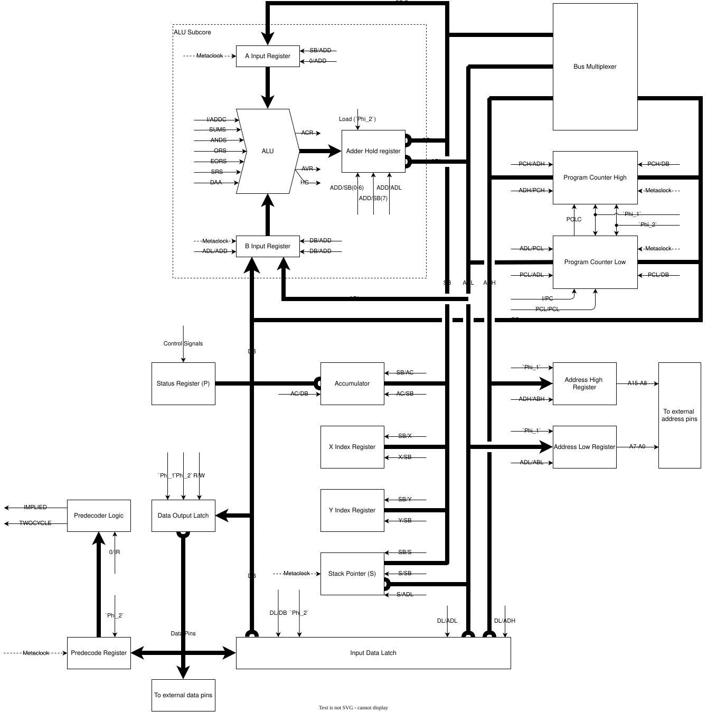

# NESgate

VHDL-based emulator for the NES, targetted at the ULX3S development board.

CI status: 

Documentation: [quigleyj97.github.io/nesgate](https://quigleyj97.github.io/nesgate/md_README.html)

Bitstreams are compiled on each change via GitHub Actions and stored for 90 days. Download the latest here: [ulx3s bitstream](https://nightly.link/quigleyj97/nesgate/workflows/synthesize/main?preview)

See the [programming section](#HProgramming) for instructions on how to upload the bitstream to your board.

## Current status

### MOS 6502

The 6502 core has substantial portions of the datapath implemented, with a working
ALU and register file.



## Building from source

### Prerequisites

The recommended toolchain is [OSS CAD Suite](https://github.com/YosysHQ/oss-cad-suite-build),
which bundles GHDL, Yosys, nextpnr-ecp5 and ecppack for Linux and macOS
(including Apple Silicon). CI uses the release pinned in
`.github/workflows/synthesize.yml`, so use the same one locally. Building HDL
tools from source (especially for macOS) is a painful adventure through the
Dungeon Dimensions. You might even become unbearably knurd.

You'll also need Python 3.12 and pipenv. The repo includes a `mise.toml` that
pins Python and sets a few environment variables needed on macOS, so the
easiest route is [mise](https://mise.jdx.dev):

```
$ mise install && pip install pipenv
$ source /path/to/oss-cad-suite/environment
$ pipenv install
$ pipenv run ./synth
```

If you don't use mise, set `PIPENV_IGNORE_VIRTUALENVS=1` after sourcing the
OSS CAD Suite environment (it sets `VIRTUAL_ENV` to itself). On macOS, also set
`LDSHARED` and `LDCXXSHARED` as in `mise.toml` before `pipenv install`, or
cocotb will fail to build.

If a tool isn't found on your PATH, `synth` falls back to running it in a
Docker container. Those images are amd64-only, so they're slow under emulation
on Apple Silicon.

### Programming

To load the resulting bitstream onto an FPGA board, use your favorite programmer.
For instance, this is the command for openFPGALoader:

```
openFPGALoader -b ulx3s -f ./build/toplevel.ulx3s.bit --unprotect-flash
```

## Organization

The project is broken down into individual, testable sub-modules in the `/cores`
folder, using some scripts to help with independent testing.

### Cores

Each core has an `analyze` script that imports each VHDL file into GHDL. It
recieves an argument to the build folder, which is necessary to ensure we can
CD into it and perform the analysis there. GHDL uses a `work-obj<STD>.cf` file
that records the _input_ paths for each file, not their absolute paths, and
it needs to be populated for elaboration to work because VHDL is a nightmare.

There is also a `test` script that is invoked to test the module independently,
this script receives the base directory to make invoking the python helpers
possible without having to actually install them as a full on module, but this
is not required.

### Targets

Right now, there's only one target supported- the ULX3S with the ECP5-85k. I
plan to extend the synthesis script to allow compilation for other targets as
well, but we'll cross that bridge when we get there.

@subpage cores